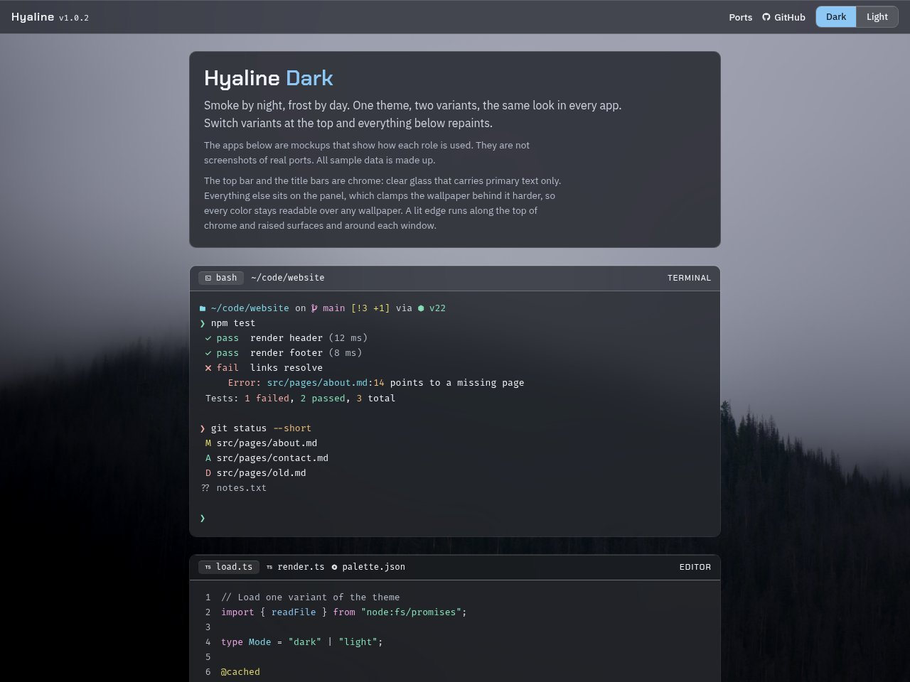
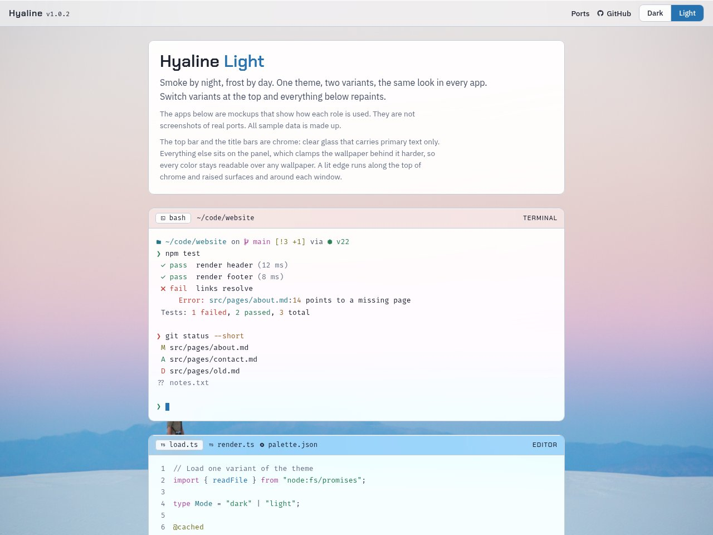

# Hyaline preview page

**Variants:** Hyaline Dark, Hyaline Light
**Tested with:** current Chrome, Firefox, and Safari

A single web page that shows what Hyaline looks like before you install anything: mock apps (terminal, editor, docs site, CI pipeline, dashboard), Mermaid diagrams, every color with its value and contrast, and how code is colored. A switch at the top flips between Dark and Light. A second page lists every port with its category, tier, and platforms, plus the planned ones, with search and category filters.

| Hyaline Dark | Hyaline Light |
|---|---|
|  |  |

## View it

- Preview: <https://mookeyj79.github.io/Hyaline/>
- Ports page: <https://mookeyj79.github.io/Hyaline/ports/>

Both open in Dark or Light to match your OS setting. To view the preview from a copy of this repo, open `Ports/preview/dist/dark/index.html` or `Ports/preview/dist/light/index.html` in a browser. The two files are the same page; only the starting variant differs.

## Known limits

- The mock apps show how Hyaline is meant to look. They are not screenshots of real ports.
- Offline, headings and body text fall back to system fonts, and the diagrams show as text. The mono font works offline.

## Sources

- [FiraCode Nerd Font](https://github.com/ryanoasis/nerd-fonts) v3.5.1, Mono, Regular and Medium, trimmed to a subset. Fira Code is by The Fira Code Project Authors under the SIL Open Font License 1.1 (`assets/fonts/LICENSE`). Icon set credits are in `assets/fonts/NERD-FONTS-README.md`.
