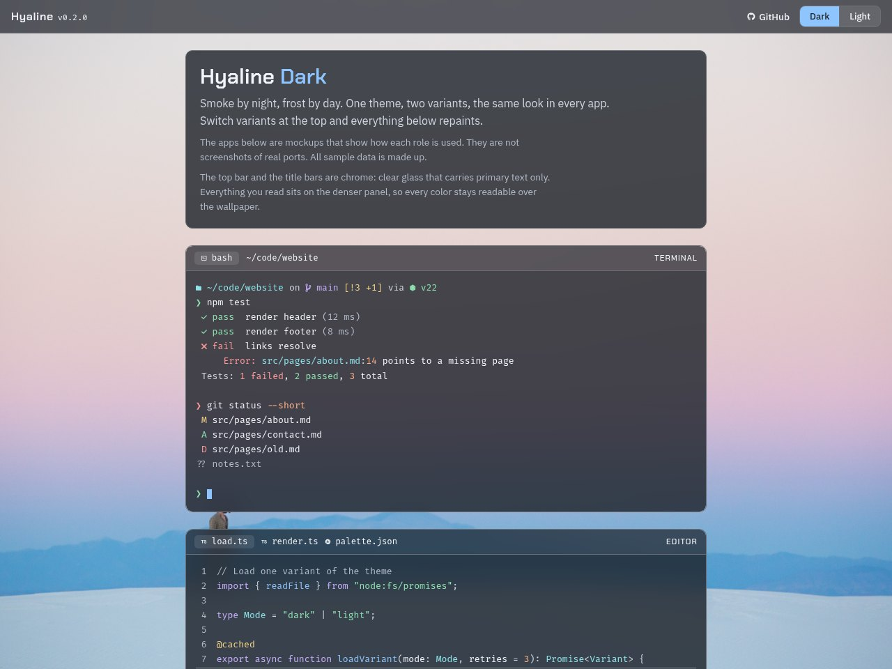
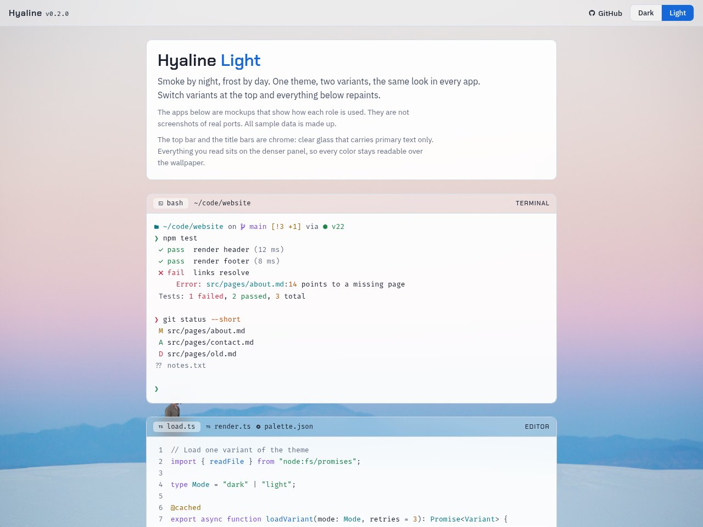

# Hyaline preview page

**Tier:** 1 Full glass
**Variants:** Hyaline Dark, Hyaline Light
**Tested with:** current Chrome, Firefox, and Safari

A single web page that shows what Hyaline looks like before you install anything: mock apps (terminal, editor, docs site, CI pipeline, dashboard), Mermaid diagrams, every role with its value and contrast, and the syntax mapping. A switch at the top flips between Dark and Light.

It also holds the ports page (`ports.html`): every port with its category, tier, and platforms, plus the planned ones, with search and category filters. The preview itself is not listed there, since it is not an app port (`unlisted` in `Ports/ports.json`).

This is not an app theme. It is treated as a port so it gets the same build and checks as every other port, and so its colors can never drift from the palette.

| Hyaline Dark | Hyaline Light |
|---|---|
|  |  |

Screenshots taken with headless Chromium at 1280 × 960. Retake them when the palette or the page changes (see CONTRIBUTING.md).

## View it

Online: <https://mookeyj79.github.io/Hyaline/> and <https://mookeyj79.github.io/Hyaline/ports/> (once GitHub Pages is turned on, see below).

Locally:

1. Run `pwsh build/build.ps1 -Port preview` from the repo root.
2. Open `Ports/preview/dist/dark/index.html` or `Ports/preview/dist/light/index.html` in a browser.
3. For the ports page, run `pwsh build/site.ps1` and open `_site/ports/index.html`. The port list (`ports.js`) only exists in the assembled site.

Both files are the same page. The only difference is which variant it opens in, so either can be linked directly.

## How it is built

- `template/theme.css` holds every role as a CSS variable, scoped to `:root[data-variant="<mode>"]`. The build renders it once per variant.
- `template/base.css` holds what both pages share: fonts, surfaces, the top bar, and the variant switch.
- `template/ports.html` reads the port list from `ports.js`, which `build/site.ps1` generates from every `Ports/<app>/port.json` and `Ports/ports.json`. Variants on each card come from which `dist/` folders exist.
- `template/index.html` loads both `../dark/theme.css` and `../light/theme.css`, so the switch repaints instantly without a reload. Without JavaScript, the switch links to the other variant's page.
- Mono text uses the recommended font, FiraCode Nerd Font Mono, from `assets/fonts/`. Those files are trimmed to the characters the page uses (Latin, ligatures, and the icons shown), so they total about 90 KB instead of 5 MB.
- The page itself holds no color values. The role values and contrast ratios in the Roles section are read from the CSS variables at runtime.
- Text never sits directly on the backdrop. Everything is on a panel, because the backdrop is light in both variants.
- The backdrop is `wallpapers/white-sands-dunes.jpg`, loaded by relative path from the repo root. The page is not self-contained: it needs the repo layout (or the Pages site, which keeps it).

## Publish with GitHub Pages

`.github/workflows/pages.yml` runs `build/site.ps1` and deploys `_site/` on every push to `main`. The root page and `/ports/` open the variant matching the visitor's OS setting.

To turn it on once:

1. On GitHub, open the repo **Settings**, then **Pages**.
2. Under **Build and deployment**, set **Source** to **GitHub Actions**.

## Update it

- Colors: change `palette/palette.json` and rebuild. The page follows.
- Content or layout: edit `template/index.html`, then run the build and the checks.
- Never edit `dist/` by hand.

---

## Reference

### Role mapping

| Page element | Role |
|---|---|
| Page background | `backdrop`, under the wallpaper |
| Top bar, window title bars | `chrome` (blurred), primary `text` only |
| Cards, window contents | `panel` (blurred) |
| Tabs, address bars, inputs, tiles, callouts | `raised` |
| Borders, dividers, meter tracks | `line` |
| Headings, content | `text` |
| Body copy, punctuation | `text_dim` |
| Metadata, comments, timestamps | `text_muted` |
| Links, focus, cursor, status bar, selected switch, primary button | `accent` with `on_accent` |
| Failed, removed, errors, destructive button | `red` |
| Passed, added, healthy | `green` |
| Warnings, modified, decorators | `yellow` |
| Running, info, functions and keys | `blue` |
| Planned, keywords, constants | `magenta` |
| Paths, types, tags | `cyan` |
| Numbers, flags, inline code | `orange` |

### Mermaid mapping

Mermaid's `base` theme, with `themeVariables` filled from the roles at runtime. Every variable the flowchart and sequence diagram read is set, so Mermaid does not lighten or darken anything on its own.

| Mermaid variables | Role |
|---|---|
| `background`, `clusterBkg`, `edgeLabelBackground`, `tertiaryColor` | `panel_flat` |
| `primaryColor`, `mainBkg`, `actorBkg`, `noteBkgColor`, `labelBoxBkgColor`, `activationBkgColor` | `raised_flat` |
| Node, actor, and label box borders | `text_muted` (they carry meaning, so 3:1) |
| `clusterBorder`, `actorLineColor`, `tertiaryBorderColor` | `line` |
| All text | `text` |
| `lineColor`, `arrowheadColor`, `signalColor`, `titleColor`, `loopTextColor` | `text_dim` |
| `noteBorderColor` | `yellow` (annotation) |
| `activationBorderColor` | `blue` (in progress) |
| `errorTextColor` | `red` |
| Status classes `ok`, `fail`, `warn`, `active`, `planned` | border in `green`, `red`, `yellow`, `blue`, `magenta`; fill stays neutral |

Diagrams use the flat roles because Mermaid draws solid SVG fills.

Status is never color alone: every status also has a word (passed, failed, running, planned) or a symbol.

### Known gaps

- Dark content glass passes, but only just: at panel alpha 0.8 the tightest role is `red` at 4.57:1 over the wallpaper. Light content is close to solid (0.93). The clear glass is in the chrome. See ADR 0004.
- No panel shadow. PHILOSOPHY.md allows one soft shadow, but the palette has no shadow role. Adding one is a palette change.
- The mock apps show how roles are used. They are not screenshots of real ports.
- Display and body fonts load from Google Fonts. Offline, the page falls back to system fonts. The mono font is bundled and works offline.
- Mermaid loads from jsDelivr (pinned to 11.4.1). Offline, the diagram source is shown as text instead.
- Only flowchart and sequence diagram variables are mapped. Other diagram types (pie, gantt, git graph, mindmap) have their own color slots and would still get Mermaid's derived colors. A full `Ports/mermaid/` port should map those and share this table.

### Sources and credits

- Layout grew out of a theme comparison mockup made while choosing Hyaline's direction. No other theme's colors are used.
- [FiraCode Nerd Font](https://github.com/ryanoasis/nerd-fonts) v3.5.1, Mono, Regular and Medium, trimmed to a subset with fontTools. Fira Code is by The Fira Code Project Authors under the SIL Open Font License 1.1 (`assets/fonts/LICENSE`). Icon set credits are in `assets/fonts/NERD-FONTS-README.md`.
