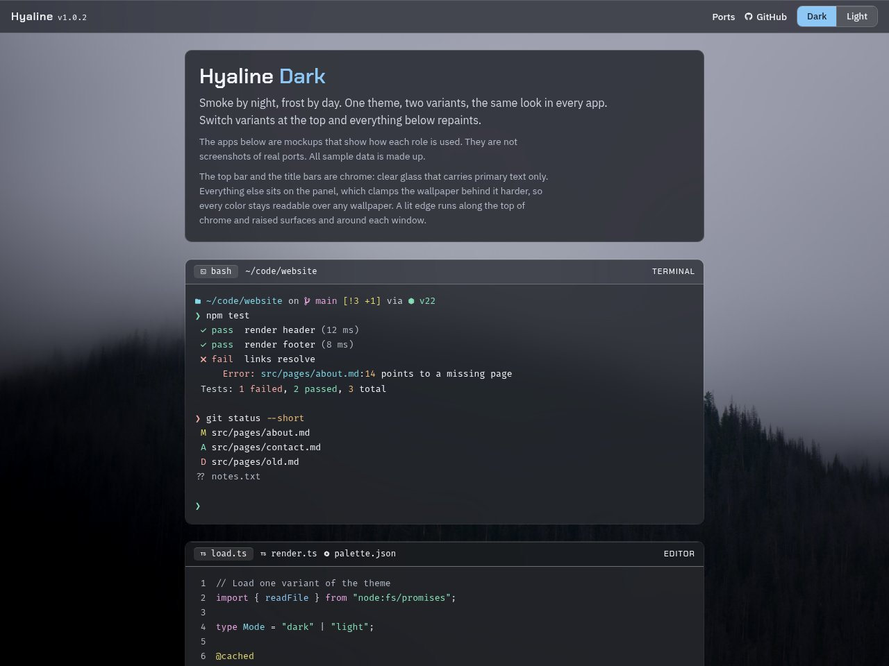
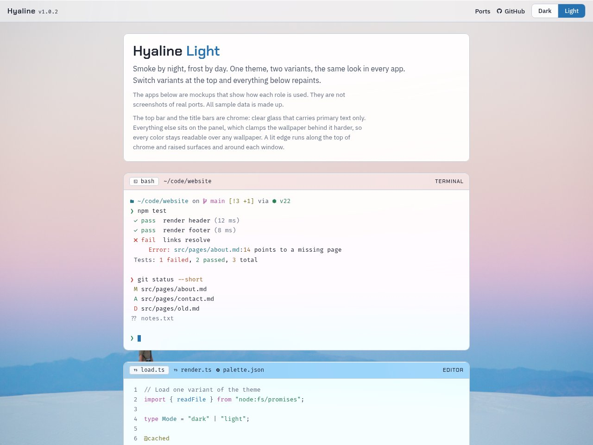
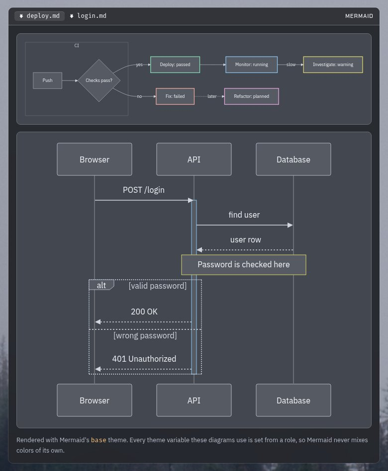
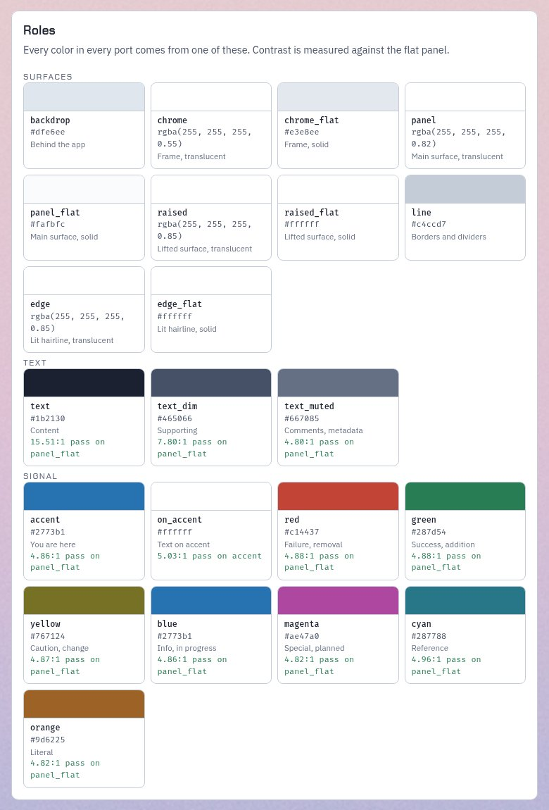
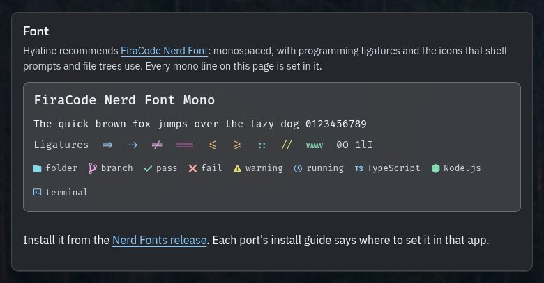

# Hyaline

*hyaline (HY-uh-lin): glassy, clear like glass.*

Smoke by night, frost by day. One color theme with two variants, ported to every app so your whole machine looks like it belongs together.

| Hyaline Dark | Hyaline Light |
|---|---|
|  |  |
| Smoked, frosted panels with light text | Frosted white panels with dark ink |

**[Open the live preview](https://mookeyj79.github.io/Hyaline/)** to see every color, mock apps, and diagrams in both variants, or **[browse the ports](https://mookeyj79.github.io/Hyaline/ports/)**.

## Contents

- [What you get](#what-you-get)
- [Ports](#ports)
- [Font](#font)
- [Wallpapers](#wallpapers)
- [How it works](#how-it-works)
- [Add a port](#add-a-port)
- [Contributing](#contributing)
- [License](#license)

## What you get

- **Two variants that always ship together.** Switching between them should feel like the sun went down, not like you opened a different app.
- **Colors with one job each.** Red is failure, green is success, yellow is change, blue is in progress, in every app. See [PHILOSOPHY.md](PHILOSOPHY.md).
- **Glass that reads over any wallpaper.** Dark, bright or busy, the glass keeps text readable, with or without blur. Pick a wallpaper because you like it.
- **Readable first.** Every text color stays easy to read, in both variants.
- **One font everywhere:** FiraCode Nerd Font, with icons for prompts and file trees.

| Diagrams | Every color | Font |
|---|---|---|
|  |  |  |

## Ports

**[Browse every port](https://mookeyj79.github.io/Hyaline/ports/)**: search by app, filter by category, and see each port's tier, platforms, and install guide. The list is generated from the ports in this repo, so it is always current. You can also browse the [`Ports/`](Ports/) folder directly.

Not every app can do glass. Each port says how far it gets:

- **Tier 1, Full glass**: full palette on translucent surfaces that stay readable over any wallpaper, with or without blur
- **Tier 2, Flat**: full palette on solid surfaces, no blur
- **Tier 3, Minimal**: background, accent, and status colors only

### Install a port

1. Open the port's folder, `Ports/<app_name>/`, and read its `README.md`. It is a step-by-step install guide.
2. Take the theme file from `dist/dark/` or `dist/light/`. Generated files are committed, so there is nothing to build.
3. Follow the guide, including **Set the font**.

## Font

Hyaline recommends **[FiraCode Nerd Font](https://www.nerdfonts.com/font-downloads)**: monospaced, with programming ligatures and the icons that shell prompts and file trees use. Every port's install guide says where to set it in that app.

1. Download [FiraCode.zip](https://github.com/ryanoasis/nerd-fonts/releases/latest/download/FiraCode.zip) from the Nerd Fonts release.
2. Unzip it and install the fonts:
   - **Windows**: select the `.ttf` files, right-click, and choose **Install for all users**.
   - **macOS**: `brew install --cask font-fira-code-nerd-font`, or double-click each `.ttf` and choose **Install Font**.
   - **Linux**: copy the `.ttf` files to `~/.local/share/fonts/` and run `fc-cache -f`.
3. In each app, pick **FiraCode Nerd Font Mono**. The Mono version keeps every icon one cell wide, so columns always line up. If an app lists only **FiraCode Nerd Font**, that works too.

Free under the SIL Open Font License.

## Wallpapers

Glass needs something behind it. [`wallpapers/`](wallpapers/) has desktop wallpapers that go well behind Hyaline, each marked with the variant it suits, free to use. See [`wallpapers/README.md`](wallpapers/README.md).

## How it works

- **One palette for every app.** Each port says what a color is for (background, text, error), never a specific color. Change a color once and every port updates.
- **Generated files are committed.** You can grab a theme from `dist/` without building anything.

### Glass

The glass, not the wallpaper, keeps text readable. Where an app can filter what is behind it, the glass blurs the wallpaper and pulls it into a dark band (Dark) or a light band (Light), the way system glass does. Where an app only has an opacity setting, the tint is dense enough to read over pure black or pure white.

The window has two kinds of glass. The **chrome** (title bars, tabs, sidebars) is the clearer one and carries only primary text. The **content** sits on a denser panel where every color stays readable.

Where an app can't do glass at all, the solid colors are chosen to look like the glass does, with a lit edge along the top of bars and raised surfaces.

### Design rules

[PHILOSOPHY.md](PHILOSOPHY.md) covers what each color means, how surfaces layer, the contrast floor, and what a port must never do. The short version:

1. Sameness beats perfection.
2. Roles, not colors.
3. The palette is mandatory, blur is a bonus.
4. Calm surface, loud signal.
5. Readable first.
6. Two variants, one theme.

## Add a port

This repo is set up for [Claude Code](https://claude.com/claude-code). Open it there and ask:

> Can you make a theme for Typora?

or run `/new-port typora`. The `new-port` skill looks up the app's theme format, picks a tier, maps the app's settings to Hyaline's colors, builds both variants, runs the checks, and writes the port's install guide.

Doing it by hand works too: see [CONTRIBUTING.md](CONTRIBUTING.md), which also covers the repo layout and the build.

## Contributing

Ports, fixes, and wallpaper suggestions are welcome. Read [CONTRIBUTING.md](CONTRIBUTING.md) for the rules every port follows and how to propose a palette change.

## License

[MIT](LICENSE), except for bundled third-party assets, which keep their own licenses:

- Wallpapers: per image, listed in [`wallpapers/README.md`](wallpapers/README.md).
- FiraCode Nerd Font in the preview page: SIL Open Font License 1.1, in [`Ports/preview/assets/fonts/`](Ports/preview/assets/fonts/).
