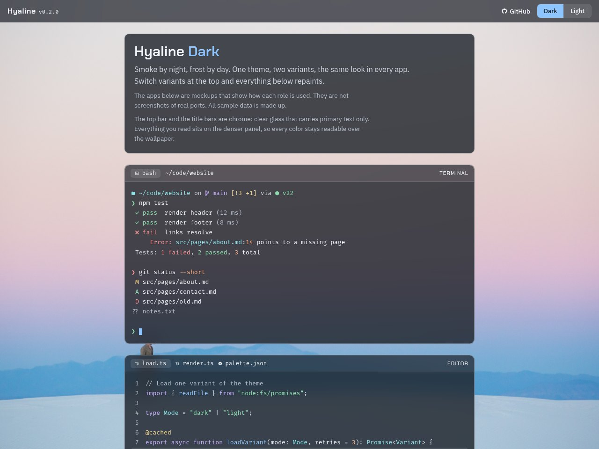
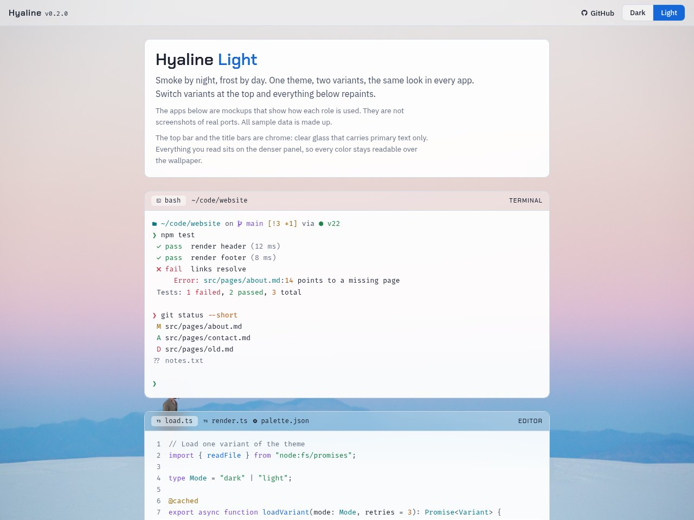
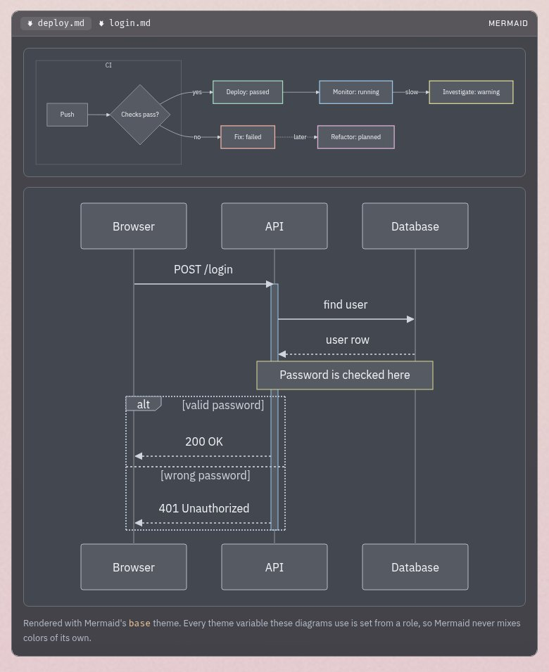
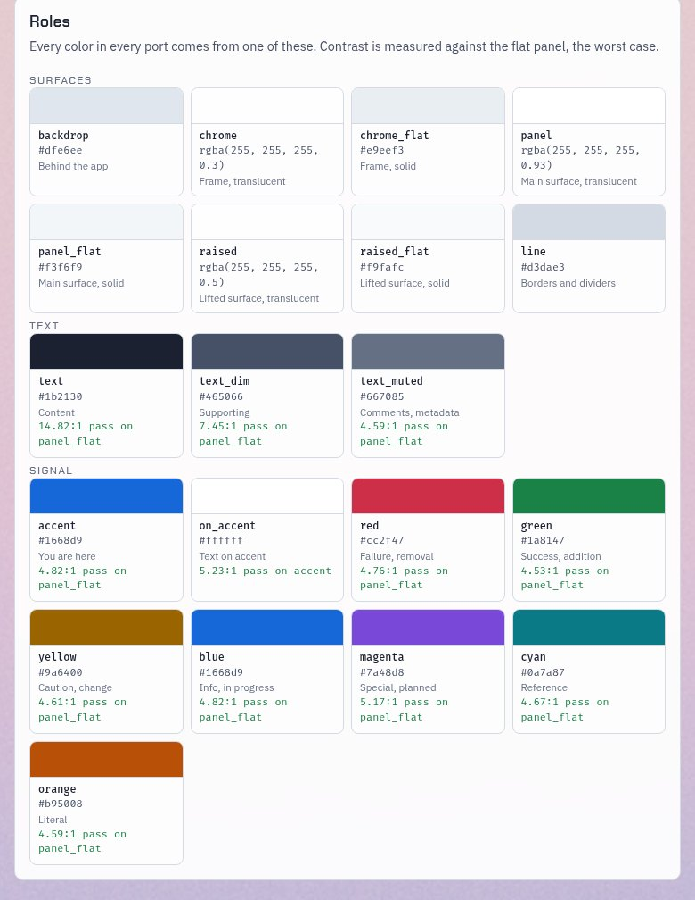
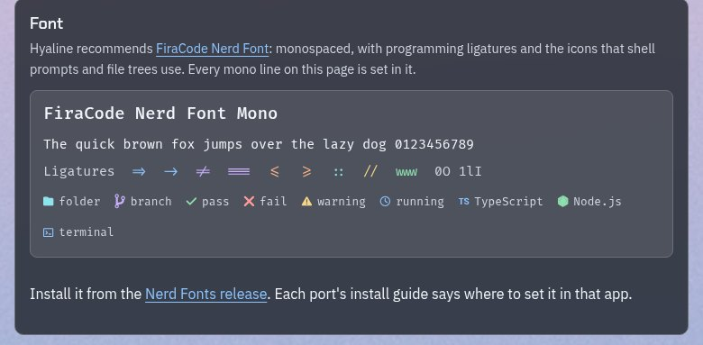

# Hyaline

[](https://github.com/mookeyj79/Hyaline/actions/workflows/check.yml)
[](LICENSE)

*hyaline (HY-uh-lin): glassy, clear like glass.*

Smoke by night, frost by day. One color theme with two variants, ported to every app so your whole machine looks like it belongs together.

| Hyaline Dark | Hyaline Light |
|---|---|
| [](https://mookeyj79.github.io/Hyaline/Ports/preview/dist/dark/index.html) | [](https://mookeyj79.github.io/Hyaline/Ports/preview/dist/light/index.html) |
| Smoked, frosted panels with light text | Frosted white panels with dark ink |

**[Open the live preview](https://mookeyj79.github.io/Hyaline/)** to see every role, mock apps, and diagrams in both variants, or **[browse the ports](https://mookeyj79.github.io/Hyaline/ports/)**.

## Contents

- [What you get](#what-you-get)
- [Ports](#ports)
- [Font](#font)
- [Wallpapers](#wallpapers)
- [How it works](#how-it-works)
- [Build](#build)
- [Add a port](#add-a-port)
- [Contributing](#contributing)
- [License](#license)

## What you get

- **Two variants that always ship together.** Switching between them should feel like the sun went down, not like you opened a different app.
- **Colors with one job each.** Red is failure, green is success, yellow is change, blue is in progress, in every app. See [PHILOSOPHY.md](PHILOSOPHY.md).
- **Glass where the app allows it.** Clear chrome (title bars, tabs, sidebars) over a wallpaper, with content on a denser panel so it stays readable.
- **Readable first.** Every text color meets a contrast floor, and CI checks it on every change.
- **One font everywhere:** FiraCode Nerd Font, with icons for prompts and file trees.

| Diagrams | Every role, with contrast | Font |
|---|---|---|
| [](https://mookeyj79.github.io/Hyaline/) | [](https://mookeyj79.github.io/Hyaline/Ports/preview/dist/light/index.html) | [](https://mookeyj79.github.io/Hyaline/) |

## Ports

**[Browse every port](https://mookeyj79.github.io/Hyaline/ports/)**: search by app, filter by category, and see each port's tier, platforms, and install guide. The list is generated from the ports in this repo, so it is always current. You can also browse the [`Ports/`](Ports/) folder directly.

Not every app can do glass. Each port says how far it gets:

- **Tier 1, Full glass**: full palette, translucency, and blur
- **Tier 2, Flat**: full palette on solid surfaces, no blur
- **Tier 3, Minimal**: background, accent, and status colors only

### Install a port

1. Open the port's folder, `Ports/<app_name>/`, and read its `README.md`. It is a step-by-step install guide.
2. Take the theme file from `dist/dark/` or `dist/light/`. Generated files are committed, so there is nothing to build.
3. Follow the guide, including **Set the font**.

## Font

Hyaline recommends **[FiraCode Nerd Font](https://www.nerdfonts.com/font-downloads)**: monospaced, with programming ligatures and the icons that shell prompts and file trees use. Every port's install guide says where to set it in that app.

1. Download [FiraCode.zip](https://github.com/ryanoasis/nerd-fonts/releases/latest/download/FiraCode.zip) from the Nerd Fonts release.
2. Unzip it and install the fonts:
   - **Windows**: select the `.ttf` files, right-click, and choose **Install for all users**.
   - **macOS**: `brew install --cask font-fira-code-nerd-font`, or double-click each `.ttf` and choose **Install Font**.
   - **Linux**: copy the `.ttf` files to `~/.local/share/fonts/` and run `fc-cache -f`.
3. In each app, pick **FiraCode Nerd Font Mono**. The Mono version keeps every icon one cell wide, so columns always line up. If an app lists only **FiraCode Nerd Font**, that works too.

Free under the SIL Open Font License. See [ADR 0005](docs/adr/0005-recommended-font.md).

## Wallpapers

[](wallpapers/white-sands-dunes.jpg)

Glass needs something behind it. [`wallpapers/`](wallpapers/) holds found images that are light, calm, and free to redistribute. Each one is credited and checked for contrast behind both variants. The first is White Sands dunes by Matt Le (CC0). See [`wallpapers/README.md`](wallpapers/README.md).

## How it works

```
palette/palette.json          every color, for both variants
Ports/<app_name>/port.json    name, category, tier, and platforms for the ports page
Ports/<app_name>/template/    theme files with {{role}} placeholders
Ports/<app_name>/dist/        generated themes, ready to use
build/                        turns palette + templates into dist, runs the checks
wallpapers/                   backdrop images, with credits
docs/adr/                     recorded decisions and why
PHILOSOPHY.md                 the design rules
```

- **The palette is the only place colors live.** Templates name a role (`panel`, `text`, `accent`, `red`), never a hex value. Change a color once and every port updates.
- **Generated files are committed.** You can grab a theme from `dist/` without building anything.
- **CI catches drift.** `check.ps1` runs on every pull request and every push to `main`, and fails if a committed theme does not match the palette.

### Glass

Where an app can blur, the window splits in two. The **chrome** (title bars, tabs, sidebars) is clear glass and carries only primary text. The **content** sits on a denser panel so every color stays readable over a wallpaper. See [ADR 0004](docs/adr/0004-chrome-and-content-glass-split.md).

### Design rules

[PHILOSOPHY.md](PHILOSOPHY.md) covers what each color means, how surfaces layer, the contrast floor, and what a port must never do. The short version:

1. Sameness beats perfection.
2. Roles, not colors.
3. The palette is mandatory, blur is a bonus.
4. Calm surface, loud signal.
5. Readable first.
6. Two variants, one theme.

## Build

Requires [PowerShell 7](https://learn.microsoft.com/powershell/scripting/install/installing-powershell).

```sh
pwsh build/build.ps1                     # rebuild every port
pwsh build/build.ps1 -Port <app_name>    # rebuild one port
pwsh build/check.ps1                     # palette, contrast, structure, port list, raw color, drift, and placeholder checks
pwsh build/site.ps1                      # assemble the Pages site (preview and ports page) into _site/
```

The preview page and the ports page are published to GitHub Pages by [`.github/workflows/pages.yml`](.github/workflows/pages.yml) on every push to `main` that changes them.

## Add a port

This repo is set up for [Claude Code](https://claude.com/claude-code). Open it there and ask:

> Can you make a theme for Typora?

or run `/new-port typora`. The `new-port` skill looks up the app's theme format, picks a tier, maps the app's settings to palette roles, builds both variants, runs the checks, and writes the port's install guide.

Doing it by hand works too: see [CONTRIBUTING.md](CONTRIBUTING.md).

## Contributing

Ports, fixes, and wallpaper suggestions are welcome. Read [CONTRIBUTING.md](CONTRIBUTING.md) for the rules every port follows and how to propose a palette change.

## License

[MIT](LICENSE), except for bundled third-party assets, which keep their own licenses:

- Wallpapers: per image, listed in [`wallpapers/README.md`](wallpapers/README.md).
- FiraCode Nerd Font in the preview page: SIL Open Font License 1.1, in [`Ports/preview/assets/fonts/`](Ports/preview/assets/fonts/).
