# Wallpapers

Desktop wallpapers that go well behind Hyaline. Each one is marked with the variant it suits: Dark, Light, or Both. Pairs (one image for each variant, in a matching style) come first, then single images. Download one and set it as your desktop background.

## Great Sand Dunes

[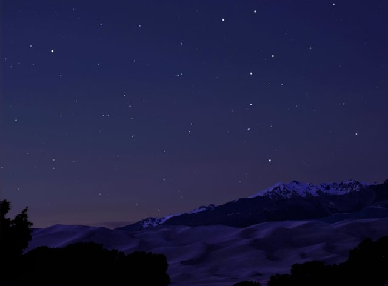](big-dipper-dunes.jpg) [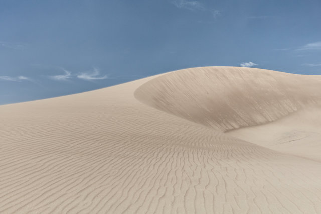](great-sand-dunes-ridge.jpg)

### Big Dipper over the dunes

| | |
|---|---|
| File | [`big-dipper-dunes.jpg`](big-dipper-dunes.jpg), 4608 × 3396, unmodified original |
| Variant | Dark |
| Subject | The Big Dipper over Great Sand Dunes, Colorado, United States, on a moonless night |
| Author | Patrick Myers, National Park Service ([Great Sand Dunes National Park and Preserve](https://www.flickr.com/people/94707653@N06)) |
| Date | 2017-02-16 |
| Source | [Wikimedia Commons](https://commons.wikimedia.org/wiki/File:Big_Dipper_Constellation_Over_Dunes_(38836718054).jpg), originally [Flickr](https://www.flickr.com/photos/greatsanddunesnpp/38836718054/) |
| License | Public domain, as a work of the United States government |

### Great Sand Dunes ridge

| | |
|---|---|
| File | [`great-sand-dunes-ridge.jpg`](great-sand-dunes-ridge.jpg), 6240 × 4160, unmodified original |
| Variant | Light |
| Subject | A sand ridge at Great Sand Dunes, Colorado, United States, under a blue sky |
| Author | [Clyde Charles Brown](https://commons.wikimedia.org/wiki/User:Semiautonomous) |
| Date | 2022-04-20 |
| Source | [Wikimedia Commons](https://commons.wikimedia.org/wiki/File:Sand_dune_at_Great_Sand_Dunes_National_Park,_Colorado,_US.jpg) |
| License | [CC BY-SA 4.0](https://creativecommons.org/licenses/by-sa/4.0) |

## White Sands dunes

[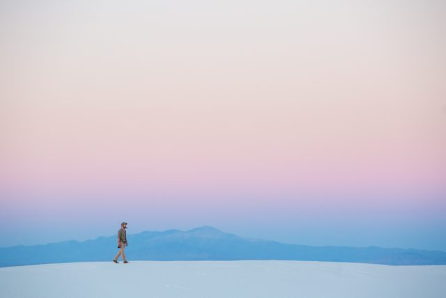](white-sands-dunes.jpg)

| | |
|---|---|
| File | [`white-sands-dunes.jpg`](white-sands-dunes.jpg), 3600 × 2400, unmodified original |
| Variant | Light |
| Subject | A hiker on the dunes at White Sands, United States, under a pink to blue sky |
| Author | Matt Le ([mattlephoto](https://unsplash.com/@mattlephoto)) |
| Date | 2016-07-20 |
| Source | [Wikimedia Commons](https://commons.wikimedia.org/wiki/File:Minimal_hike_on_the_dunes_(Unsplash).jpg), originally [Unsplash](https://unsplash.com/photos/SJSpo9hQf7s) |
| License | [CC0 1.0, public domain dedication](https://creativecommons.org/publicdomain/zero/1.0/). Credit is not required, but we give it anyway. |

## Forest under gray sky

| | |
|---|---|
| File | [`forest-under-gray-sky.jpg`](forest-under-gray-sky.jpg), 6016 × 4016, unmodified original |
| Variant | Dark |
| Subject | Fog over a dark forested ridge in Colorado, United States |
| Author | Nathan Anderson ([nathananderson](https://unsplash.com/@nathananderson)) |
| Date | 2016-08-27 |
| Source | [Wikimedia Commons](https://commons.wikimedia.org/wiki/File:Forest_under_gray_sky_(Unsplash).jpg), originally [Unsplash](https://unsplash.com/photos/_zHYUQmWrzk) |
| License | [CC0 1.0, public domain dedication](https://creativecommons.org/publicdomain/zero/1.0/). Credit is not required, but we give it anyway. |

## Lofoten aurora

[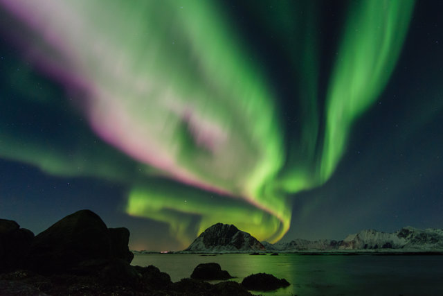](lofoten-aurora.jpg)

| | |
|---|---|
| File | [`lofoten-aurora.jpg`](lofoten-aurora.jpg), 5059 × 3373, unmodified original |
| Variant | Dark |
| Subject | Green and pink northern lights over the rocky shore of Lofoten, Norway |
| Author | Johannes Groll ([followhansi](https://unsplash.com/@followhansi)) |
| Date | 2017-05-08 |
| Source | [Wikimedia Commons](https://commons.wikimedia.org/wiki/File:Lofoten,_Norway_(Unsplash).jpg), originally [Unsplash](https://unsplash.com/photos/upXoQv5GAr8) |
| License | [CC0 1.0, public domain dedication](https://creativecommons.org/publicdomain/zero/1.0/). Credit is not required, but we give it anyway. |

## Abisko aurora

[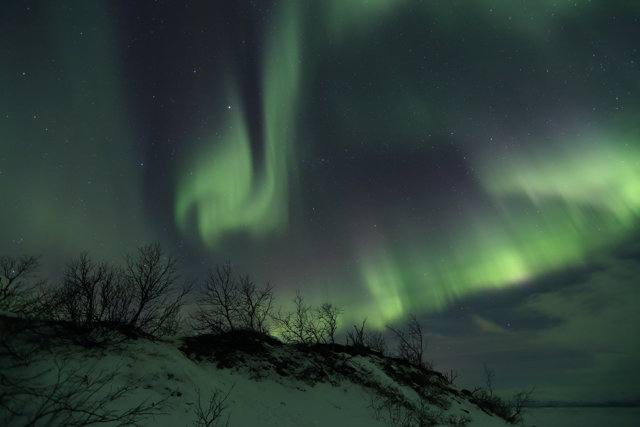](abisko-aurora.jpg)

| | |
|---|---|
| File | [`abisko-aurora.jpg`](abisko-aurora.jpg), 5442 × 3628, unmodified original |
| Variant | Dark |
| Subject | Northern lights over snowy shrubs near Torneträsk in Abisko, Sweden |
| Author | Pavel.shyshkouski |
| Date | 2018-03-09 |
| Source | [Wikimedia Commons](https://commons.wikimedia.org/wiki/File:Aurora_in_Abisko_near_Tornetr%C3%A4sk.jpg) |
| License | [CC BY-SA 4.0](https://creativecommons.org/licenses/by-sa/4.0) |

## Maardu aurora

[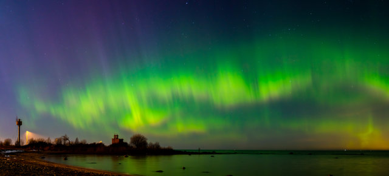](maardu-aurora.jpg)

| | |
|---|---|
| File | [`maardu-aurora.jpg`](maardu-aurora.jpg), 8095 × 3662, unmodified original |
| Variant | Dark |
| Subject | A bright band of northern lights over the coast at Maardu, Estonia |
| Author | Maxim Bilovitskiy |
| Date | 2022-03-14 |
| Source | [Wikimedia Commons](https://commons.wikimedia.org/wiki/File:Maardu_Northern_lights_%E2%80%94_Estonia,_2022.jpg) |
| License | [CC BY 4.0](https://creativecommons.org/licenses/by/4.0) |

## Marukha Milky Way

[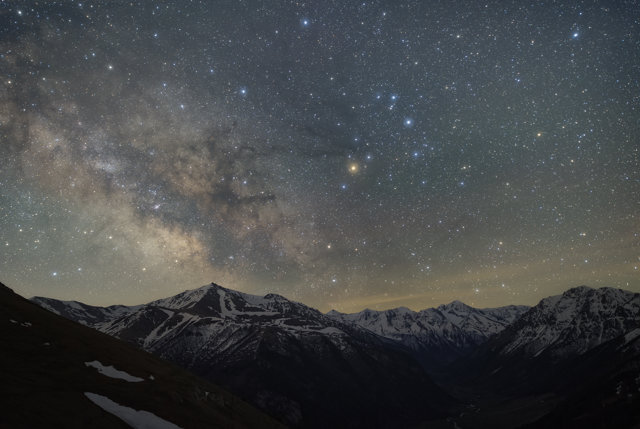](marukha-milky-way.jpg)

| | |
|---|---|
| File | [`marukha-milky-way.jpg`](marukha-milky-way.jpg), 5384 × 3612, unmodified original |
| Variant | Dark |
| Subject | The Milky Way over the snowy peaks of the Marukha valley, Arkhyz, Russia |
| Author | Alexander Kurilov |
| Date | 2021-07-02 |
| Source | [Wikimedia Commons](https://commons.wikimedia.org/wiki/File:Milky_Way_over_the_valley_of_Marukha_River,_Arkhyz,_Russi%D0%B0.jpg) |
| License | [CC BY 4.0](https://creativecommons.org/licenses/by/4.0) |

## Kaçkar night sky

[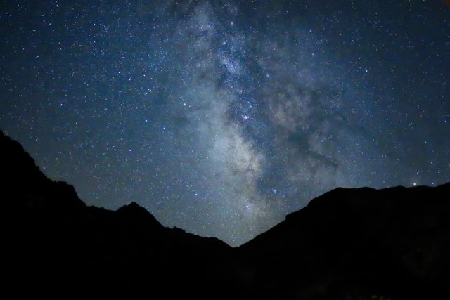](kackar-night-sky.jpg)

| | |
|---|---|
| File | [`kackar-night-sky.jpg`](kackar-night-sky.jpg), 3728 × 2486, unmodified original |
| Variant | Dark |
| Subject | The Milky Way above the dark ridges of the Kaçkar Mountains, Türkiye |
| Author | Kadir KARA |
| Date | 2015-07-21 |
| Source | [Wikimedia Commons](https://commons.wikimedia.org/wiki/File:Ka%C3%A7kar_Mountains_Night_Sky_View.jpg) |
| License | [CC BY-SA 4.0](https://creativecommons.org/licenses/by-sa/4.0) |

## Bontecou Lake Milky Way

[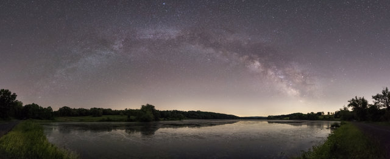](bontecou-milky-way.jpg)

| | |
|---|---|
| File | [`bontecou-milky-way.jpg`](bontecou-milky-way.jpg), 9640 × 3949, unmodified original |
| Variant | Dark |
| Subject | The Milky Way arching over Bontecou Lake, New York, United States |
| Author | [Juliancolton](https://commons.wikimedia.org/wiki/User:Juliancolton) |
| Date | 2017-06-21 |
| Source | [Wikimedia Commons](https://commons.wikimedia.org/wiki/File:Bontecou_Lake_Milky_Way_panorama.jpg) |
| License | [CC BY-SA 4.0](https://creativecommons.org/licenses/by-sa/4.0) |

## Luhasoo Perseid

[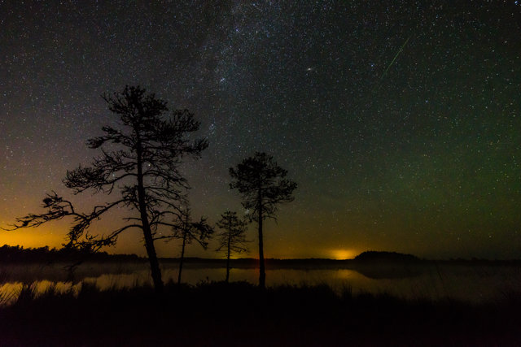](luhasoo-perseid.jpg)

| | |
|---|---|
| File | [`luhasoo-perseid.jpg`](luhasoo-perseid.jpg), 6016 × 4016, unmodified original |
| Variant | Dark |
| Subject | A Perseid meteor and the Milky Way over pine trees in Luhasoo bog, Estonia |
| Author | [Martin Mark](https://commons.wikimedia.org/wiki/User:Matugraphy) |
| Date | 2015-08-12 |
| Source | [Wikimedia Commons](https://commons.wikimedia.org/wiki/File:In_the_photo_there_is_one_Perseid,_Milky_Way_and_Andromega_galaxy_and_light_pollution_on_the_horizon_-_Luhasoo_bog_in_Estonia.jpg) |
| License | [CC BY-SA 4.0](https://creativecommons.org/licenses/by-sa/4.0) |

## Angel's Rest

[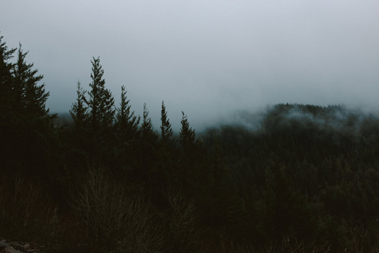](angels-rest.jpg)

| | |
|---|---|
| File | [`angels-rest.jpg`](angels-rest.jpg), 4896 × 3264, unmodified original |
| Variant | Dark |
| Subject | Fog over a dark coniferous forest |
| Author | Brandon Mattingly ([brandonmattingly](https://unsplash.com/@brandonmattingly)) |
| Date | 2017-01-21 |
| Source | [Wikimedia Commons](https://commons.wikimedia.org/wiki/File:Angel%27s_Rest_(Unsplash).jpg), originally [Unsplash](https://unsplash.com/photos/QIiil-qdlvo) |
| License | [CC0 1.0, public domain dedication](https://creativecommons.org/publicdomain/zero/1.0/). Credit is not required, but we give it anyway. |

## Mälaren fog

[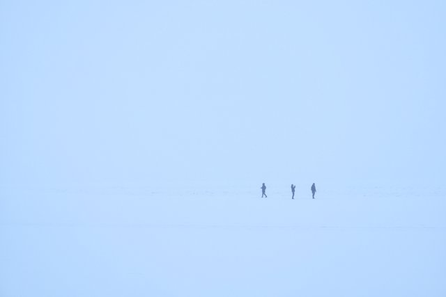](malaren-fog.jpg)

| | |
|---|---|
| File | [`malaren-fog.jpg`](malaren-fog.jpg), 4592 × 3064, unmodified original |
| Variant | Light |
| Subject | Three people far out on a pale blue, fog-covered Lake Mälaren, Sweden |
| Author | [Yousef Tavakoli](https://commons.wikimedia.org/wiki/User:Ytvkli) |
| Date | 2019-01-26 |
| Source | [Wikimedia Commons](https://commons.wikimedia.org/wiki/File:Fog_in_M%C3%A4laren_lake.jpg) |
| License | [CC BY-SA 4.0](https://creativecommons.org/licenses/by-sa/4.0) |

## Pastel clouds

[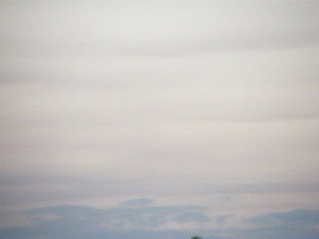](pastel-clouds.jpg)

| | |
|---|---|
| File | [`pastel-clouds.jpg`](pastel-clouds.jpg), 3264 × 2448, unmodified original |
| Variant | Light |
| Subject | Soft clouds in pale pink and gray over Geebung, Australia |
| Author | [John Robert McPherson](https://commons.wikimedia.org/wiki/User:John_Robert_McPherson) |
| Date | 2008-01-09 |
| Source | [Wikimedia Commons](https://commons.wikimedia.org/wiki/File:Clouds_in_pastel_shades,_Picadilly_St_Geebung_DSCF1147.jpg) |
| License | [CC BY-SA 4.0](https://creativecommons.org/licenses/by-sa/4.0) |

## Trustom Pond fog

[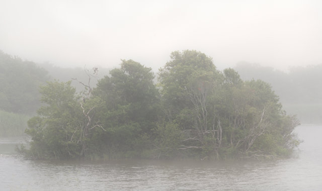](trustom-pond-fog.jpg)

| | |
|---|---|
| File | [`trustom-pond-fog.jpg`](trustom-pond-fog.jpg), 8135 × 4831, unmodified original |
| Variant | Light |
| Subject | A wooded island in white fog on Trustom Pond, Rhode Island, United States |
| Author | [Rhododendrites](https://commons.wikimedia.org/wiki/User:Rhododendrites) |
| Date | 2021-06-21 |
| Source | [Wikimedia Commons](https://commons.wikimedia.org/wiki/File:Trustom_Pond_in_the_fog_(12453p)2.jpg) |
| License | [CC BY-SA 4.0](https://creativecommons.org/licenses/by-sa/4.0) |

## Wanaka fog

[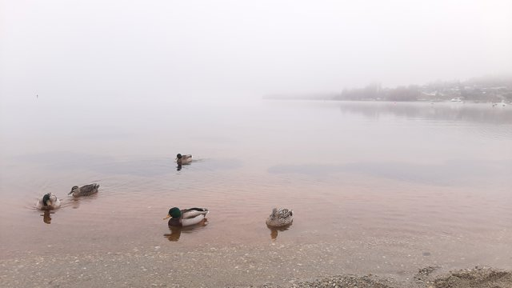](wanaka-fog.jpg)

| | |
|---|---|
| File | [`wanaka-fog.jpg`](wanaka-fog.jpg), 4032 × 2268, unmodified original |
| Variant | Light |
| Subject | Ducks on Lake Wanaka, New Zealand, under morning fog |
| Author | BlakeyboiWikiMed |
| Date | 2024-07-20 |
| Source | [Wikimedia Commons](https://commons.wikimedia.org/wiki/File:Lake_Wanaka_with_fog.jpg) |
| License | [CC BY-SA 4.0](https://creativecommons.org/licenses/by-sa/4.0) |

## Great Sand Dunes haze

[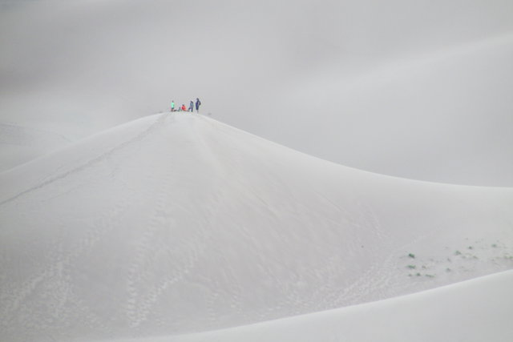](great-sand-dunes-haze.jpg)

| | |
|---|---|
| File | [`great-sand-dunes-haze.jpg`](great-sand-dunes-haze.jpg), 4608 × 3072, unmodified original |
| Variant | Light |
| Subject | Hikers on a pale dune ridge in gray haze at Great Sand Dunes, Colorado, United States |
| Author | [Chris Light](https://commons.wikimedia.org/wiki/User:Chris_Light) |
| Date | 2016-07-21 |
| Source | [Wikimedia Commons](https://commons.wikimedia.org/wiki/File:Great_Sand_Dunes_National_Park_in_southern_Colorado_2016.jpg) |
| License | [CC BY-SA 4.0](https://creativecommons.org/licenses/by-sa/4.0) |

## Bonneville sunrise

[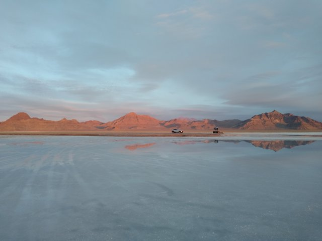](bonneville-sunrise.jpg)

| | |
|---|---|
| File | [`bonneville-sunrise.jpg`](bonneville-sunrise.jpg), 4096 × 3072, unmodified original |
| Variant | Light |
| Subject | Sunrise over the Bonneville Salt Flats, Utah, United States, with mountains reflected in water |
| Author | [Mx. Granger](https://commons.wikimedia.org/wiki/User:Mx._Granger) |
| Date | 2021-12-06 |
| Source | [Wikimedia Commons](https://commons.wikimedia.org/wiki/File:Sunrise_at_the_Bonneville_Salt_Flats_4.jpg) |
| License | [CC0 1.0, public domain dedication](https://creativecommons.org/publicdomain/zero/1.0/). Credit is not required, but we give it anyway. |

## White sand waves

[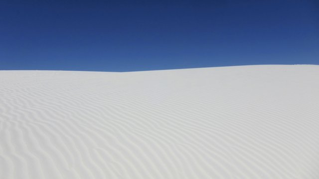](white-sand-waves.jpg)

| | |
|---|---|
| File | [`white-sand-waves.jpg`](white-sand-waves.jpg), 3648 × 2048, unmodified original |
| Variant | Light |
| Subject | Wind ripples on a white sand dune under a deep blue sky |
| Author | B1db2 |
| Date | 2013-03-01 |
| Source | [Wikimedia Commons](https://commons.wikimedia.org/wiki/File:White_sand_waves.jpg) |
| License | [CC BY-SA 4.0](https://creativecommons.org/licenses/by-sa/4.0) |

## Pastel dawn

[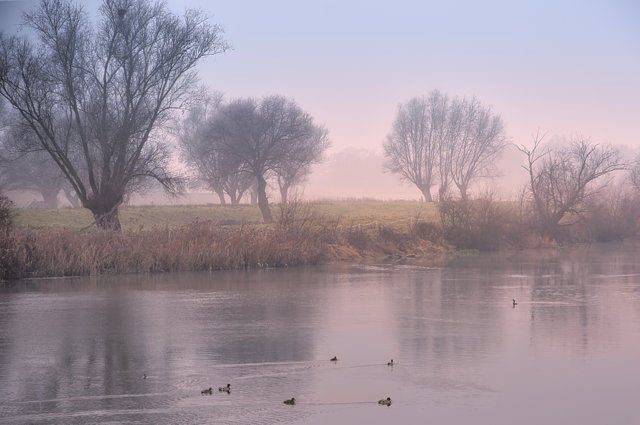](pastel-dawn.jpg)

| | |
|---|---|
| File | [`pastel-dawn.jpg`](pastel-dawn.jpg), 5060 × 3360, unmodified original |
| Variant | Light |
| Subject | Bare willows and still water under a pink and lilac dawn sky |
| Author | [Bogdan Zaleski](https://www.flickr.com/people/202328128@N05) |
| Date | 2025-12-16 |
| Source | [Wikimedia Commons](https://commons.wikimedia.org/wiki/File:Pastel_Dawn_-_Flickr_-_bzaleski873.jpg), originally [Flickr](https://www.flickr.com/photos/202328128@N05/55024914736/) |
| License | [CC BY 4.0](https://creativecommons.org/licenses/by/4.0) |

## Silesia fog

[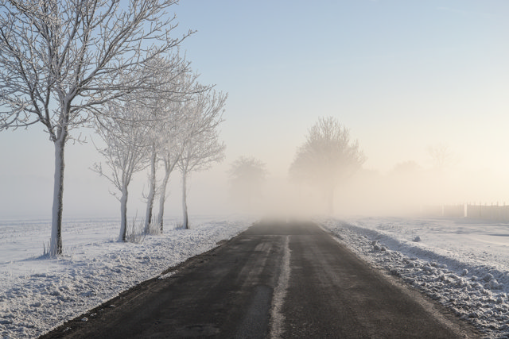](silesia-fog.jpg)

| | |
|---|---|
| File | [`silesia-fog.jpg`](silesia-fog.jpg), 4553 × 3035, unmodified original |
| Variant | Light |
| Subject | A frosty road lined with trees, fading into morning fog in Upper Silesia, Poland |
| Author | [Pudelek](https://commons.wikimedia.org/wiki/User:Pudelek) |
| Date | 2019-02-05 |
| Source | [Wikimedia Commons](https://commons.wikimedia.org/wiki/File:Morning_fog_in_Upper_Silesia.jpg) |
| License | [CC BY-SA 4.0](https://creativecommons.org/licenses/by-sa/4.0) |
