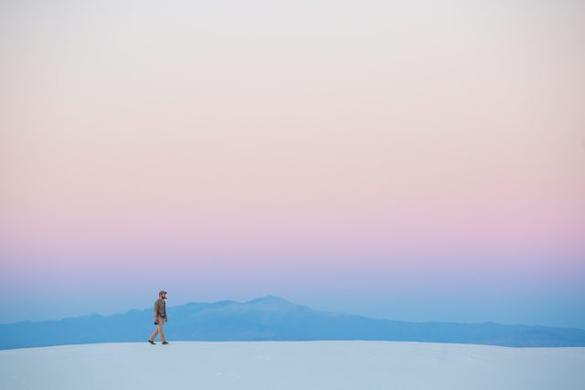

# Wallpapers

Found images that sit behind Hyaline's glass as the backdrop. They are the one exception to "no color values outside the palette": they are image assets, not colors. See [ADR 0003](../docs/adr/0003-wallpapers-are-found-images.md).

Every wallpaper here:

- has a license that allows redistribution, recorded below
- has its author and source credited below
- is light, low detail, and low saturation
- has been checked behind both variants (see the contrast note for each)

## White Sands dunes

| | |
|---|---|
| File | [`white-sands-dunes.jpg`](white-sands-dunes.jpg), 3600 × 2400, unmodified original |
| Subject | A hiker on the dunes at White Sands, United States, under a pink to blue sky |
| Author | Matt Le ([mattlephoto](https://unsplash.com/@mattlephoto)) |
| Date | 2016-07-20 |
| Source | [Wikimedia Commons](https://commons.wikimedia.org/wiki/File:Minimal_hike_on_the_dunes_(Unsplash).jpg), originally [Unsplash](https://unsplash.com/photos/SJSpo9hQf7s) |
| License | [CC0 1.0, public domain dedication](https://creativecommons.org/publicdomain/zero/1.0/). Credit is not required, but we give it anyway. |

**Behind the panels.** Measured over the whole image with an 18 px blur, the worst-case spot for each role:

| Surface | Hyaline Dark | Hyaline Light |
|---|---|---|
| `chrome` (primary text only) | alpha 0.70: `text` 6.24:1, `text` on a tab 4.87:1 | alpha 0.30: `text` 5.70:1, `text` on a tab 10.04:1 |
| `panel` (every role) | alpha 0.80: all pass, tightest `red` 4.57:1 | alpha 0.93: all pass, tightest color role 4.50:1 |

Measured for palette 0.2.0. See [ADR 0004](../docs/adr/0004-chrome-and-content-glass-split.md).

## Adding a wallpaper

1. Confirm the license allows redistribution (CC0 or public domain is simplest). Record it.
2. Save the original, unmodified, as `wallpapers/<short-name>.jpg`.
3. Save a 640 px wide thumbnail as `wallpapers/thumbs/<short-name>.jpg`.
4. Add a section above with the thumbnail, author, date, source links, and license.
5. Check it behind both variants, on both `chrome` and `panel`, and record the result. Every role must pass on `panel` and primary `text` must pass on `chrome`.
